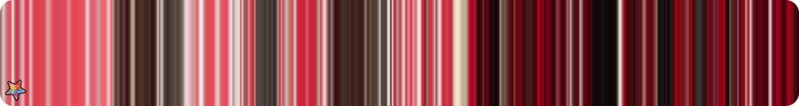
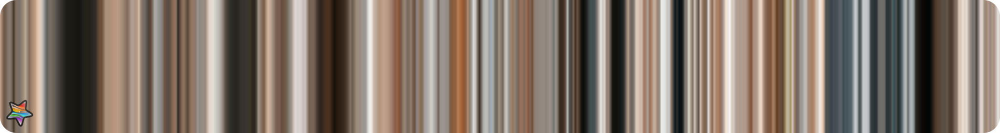
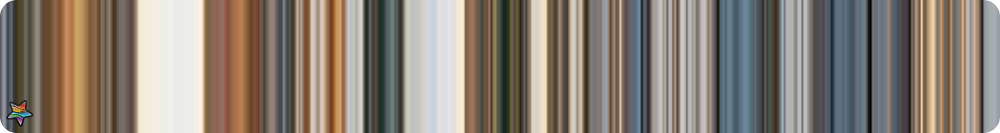
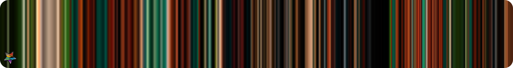

# F3H_LOCK_alexnardini_ArchViz_HQ_set_A.json
- #### THIS FILE IS ONLY INFORMATIVE and part of the Documentations

 

- #### Quick links

  - **FLAM3H™** [**UI_ICON_map H19.0 to H20.0**](../../../src/F3H_UI_ICON_H19_to_H20.md)
  - **FLAM3H™** [**UI_ICON_map H20.5 to H22.0 UP**](../../../src/F3H_UI_ICON_H205_to_H22_UP.md)
  - **FLAM3H™** [**PY_PARM_map H19.0 to H20.0**](../../../src/F3H_PY_PARM_H19_to_H20.md)
  - **FLAM3H™** [**PY_PARM_map H20.5 to H22.0 UP**](../../../src/F3H_PY_PARM_H205_to_H22_UP.md)

   

  - **FLAM3H™USD** [**UI_ICON_map**](../../../src/F3HUSD_UI_ICON.md)
  - **FLAM3H™USD** [**PY_PARM_map H19 to H20**](../../../src/F3HUSD_PY_PARM_H19_to_H20.md)
  - **FLAM3H™USD** [**PY_PARM_map H20.5 to H22 UP**](../../../src/F3HUSD_PY_PARM_H205_to_H22_UP.md)

   

    - [**FULL ICON SET**](../../../icons/README.md)
    - [**PALETTE PREVIEWS**](../../../__FLAM3H_palette_libs/README.md)

   

    - [**FLAME PRESETS**](../../../__FLAM3H_flame_libs/README.md)

 
 
 
 

# Contents

 
 

- #   json
- ## File name: [**`F3H_LOCK_alexnardini_ArchViz_HQ_set_A.json`**](../../F3H_LOCK_alexnardini_ArchViz_HQ_set_A.json) _color keys_: **512**
    1. - `ArchViz_HQ_set_A_01` [**`f3h_hex`**](https://github.com/alexnardini/FLAM3_for_SideFX_Houdini/blob/47b9fd38fcf0def532eba72d02d2eb11118d36c8/__FLAM3H_palette_libs/F3H_LOCK_alexnardini_ArchViz_HQ_set_A.json#L2-L4)  
    2. - `ArchViz_HQ_set_A_02` [**`f3h_hex`**](https://github.com/alexnardini/FLAM3_for_SideFX_Houdini/blob/47b9fd38fcf0def532eba72d02d2eb11118d36c8/__FLAM3H_palette_libs/F3H_LOCK_alexnardini_ArchViz_HQ_set_A.json#L5-L7)  
    3. - `ArchViz_HQ_set_A_03` [**`f3h_hex`**](https://github.com/alexnardini/FLAM3_for_SideFX_Houdini/blob/47b9fd38fcf0def532eba72d02d2eb11118d36c8/__FLAM3H_palette_libs/F3H_LOCK_alexnardini_ArchViz_HQ_set_A.json#L8-L10)  
    4. - `ArchViz_HQ_set_A_04` [**`f3h_hex`**](https://github.com/alexnardini/FLAM3_for_SideFX_Houdini/blob/47b9fd38fcf0def532eba72d02d2eb11118d36c8/__FLAM3H_palette_libs/F3H_LOCK_alexnardini_ArchViz_HQ_set_A.json#L11-L13)  
    5. - `ArchViz_HQ_set_A_05` [**`f3h_hex`**](https://github.com/alexnardini/FLAM3_for_SideFX_Houdini/blob/47b9fd38fcf0def532eba72d02d2eb11118d36c8/__FLAM3H_palette_libs/F3H_LOCK_alexnardini_ArchViz_HQ_set_A.json#L14-L16)  
    6. - `ArchViz_HQ_set_A_06` [**`f3h_hex`**](https://github.com/alexnardini/FLAM3_for_SideFX_Houdini/blob/47b9fd38fcf0def532eba72d02d2eb11118d36c8/__FLAM3H_palette_libs/F3H_LOCK_alexnardini_ArchViz_HQ_set_A.json#L17-L19)  
    7. - `ArchViz_HQ_set_A_07` [**`f3h_hex`**](https://github.com/alexnardini/FLAM3_for_SideFX_Houdini/blob/47b9fd38fcf0def532eba72d02d2eb11118d36c8/__FLAM3H_palette_libs/F3H_LOCK_alexnardini_ArchViz_HQ_set_A.json#L20-L22)  
    8. - `ArchViz_HQ_set_A_08` [**`f3h_hex`**](https://github.com/alexnardini/FLAM3_for_SideFX_Houdini/blob/47b9fd38fcf0def532eba72d02d2eb11118d36c8/__FLAM3H_palette_libs/F3H_LOCK_alexnardini_ArchViz_HQ_set_A.json#L23-L25)  
    9. - `ArchViz_HQ_set_A_09` [**`f3h_hex`**](https://github.com/alexnardini/FLAM3_for_SideFX_Houdini/blob/47b9fd38fcf0def532eba72d02d2eb11118d36c8/__FLAM3H_palette_libs/F3H_LOCK_alexnardini_ArchViz_HQ_set_A.json#L26-L28)  
    10. - `ArchViz_HQ_set_A_10` [**`f3h_hex`**](https://github.com/alexnardini/FLAM3_for_SideFX_Houdini/blob/47b9fd38fcf0def532eba72d02d2eb11118d36c8/__FLAM3H_palette_libs/F3H_LOCK_alexnardini_ArchViz_HQ_set_A.json#L29-L31)  
    11. - `ArchViz_HQ_set_A_11` [**`f3h_hex`**](https://github.com/alexnardini/FLAM3_for_SideFX_Houdini/blob/47b9fd38fcf0def532eba72d02d2eb11118d36c8/__FLAM3H_palette_libs/F3H_LOCK_alexnardini_ArchViz_HQ_set_A.json#L32-L34)  
    12. - `ArchViz_HQ_set_A_12` [**`f3h_hex`**](https://github.com/alexnardini/FLAM3_for_SideFX_Houdini/blob/47b9fd38fcf0def532eba72d02d2eb11118d36c8/__FLAM3H_palette_libs/F3H_LOCK_alexnardini_ArchViz_HQ_set_A.json#L35-L37)  
    13. - `ArchViz_HQ_set_A_13` [**`f3h_hex`**](https://github.com/alexnardini/FLAM3_for_SideFX_Houdini/blob/47b9fd38fcf0def532eba72d02d2eb11118d36c8/__FLAM3H_palette_libs/F3H_LOCK_alexnardini_ArchViz_HQ_set_A.json#L38-L40)  
    14. - `ArchViz_HQ_set_A_14` [**`f3h_hex`**](https://github.com/alexnardini/FLAM3_for_SideFX_Houdini/blob/47b9fd38fcf0def532eba72d02d2eb11118d36c8/__FLAM3H_palette_libs/F3H_LOCK_alexnardini_ArchViz_HQ_set_A.json#L41-L43)  
    15. - `ArchViz_HQ_set_A_15` [**`f3h_hex`**](https://github.com/alexnardini/FLAM3_for_SideFX_Houdini/blob/47b9fd38fcf0def532eba72d02d2eb11118d36c8/__FLAM3H_palette_libs/F3H_LOCK_alexnardini_ArchViz_HQ_set_A.json#L44-L46)  
    16. - `ArchViz_HQ_set_A_16` [**`f3h_hex`**](https://github.com/alexnardini/FLAM3_for_SideFX_Houdini/blob/47b9fd38fcf0def532eba72d02d2eb11118d36c8/__FLAM3H_palette_libs/F3H_LOCK_alexnardini_ArchViz_HQ_set_A.json#L47-L49)  
    17. - `ArchViz_HQ_set_A_17` [**`f3h_hex`**](https://github.com/alexnardini/FLAM3_for_SideFX_Houdini/blob/47b9fd38fcf0def532eba72d02d2eb11118d36c8/__FLAM3H_palette_libs/F3H_LOCK_alexnardini_ArchViz_HQ_set_A.json#L50-L52)  
    18. - `ArchViz_HQ_set_A_18` [**`f3h_hex`**](https://github.com/alexnardini/FLAM3_for_SideFX_Houdini/blob/47b9fd38fcf0def532eba72d02d2eb11118d36c8/__FLAM3H_palette_libs/F3H_LOCK_alexnardini_ArchViz_HQ_set_A.json#L53-L55)  
    19. - `ArchViz_HQ_set_A_19` [**`f3h_hex`**](https://github.com/alexnardini/FLAM3_for_SideFX_Houdini/blob/47b9fd38fcf0def532eba72d02d2eb11118d36c8/__FLAM3H_palette_libs/F3H_LOCK_alexnardini_ArchViz_HQ_set_A.json#L56-L58)  
    20. - `ArchViz_HQ_set_A_20` [**`f3h_hex`**](https://github.com/alexnardini/FLAM3_for_SideFX_Houdini/blob/47b9fd38fcf0def532eba72d02d2eb11118d36c8/__FLAM3H_palette_libs/F3H_LOCK_alexnardini_ArchViz_HQ_set_A.json#L59-L61)  
    21. - `ArchViz_HQ_set_A_21` [**`f3h_hex`**](https://github.com/alexnardini/FLAM3_for_SideFX_Houdini/blob/47b9fd38fcf0def532eba72d02d2eb11118d36c8/__FLAM3H_palette_libs/F3H_LOCK_alexnardini_ArchViz_HQ_set_A.json#L62-L64)  
    22. - `ArchViz_HQ_set_A_22` [**`f3h_hex`**](https://github.com/alexnardini/FLAM3_for_SideFX_Houdini/blob/47b9fd38fcf0def532eba72d02d2eb11118d36c8/__FLAM3H_palette_libs/F3H_LOCK_alexnardini_ArchViz_HQ_set_A.json#L65-L67)  
    23. - `ArchViz_HQ_set_A_23` [**`f3h_hex`**](https://github.com/alexnardini/FLAM3_for_SideFX_Houdini/blob/47b9fd38fcf0def532eba72d02d2eb11118d36c8/__FLAM3H_palette_libs/F3H_LOCK_alexnardini_ArchViz_HQ_set_A.json#L68-L70)  
    24. - `ArchViz_HQ_set_A_24` [**`f3h_hex`**](https://github.com/alexnardini/FLAM3_for_SideFX_Houdini/blob/47b9fd38fcf0def532eba72d02d2eb11118d36c8/__FLAM3H_palette_libs/F3H_LOCK_alexnardini_ArchViz_HQ_set_A.json#L71-L73)  
    25. - `ArchViz_HQ_set_A_25` [**`f3h_hex`**](https://github.com/alexnardini/FLAM3_for_SideFX_Houdini/blob/47b9fd38fcf0def532eba72d02d2eb11118d36c8/__FLAM3H_palette_libs/F3H_LOCK_alexnardini_ArchViz_HQ_set_A.json#L74-L76)  
    26. - `ArchViz_HQ_set_A_26` [**`f3h_hex`**](https://github.com/alexnardini/FLAM3_for_SideFX_Houdini/blob/47b9fd38fcf0def532eba72d02d2eb11118d36c8/__FLAM3H_palette_libs/F3H_LOCK_alexnardini_ArchViz_HQ_set_A.json#L77-L79)  

 
 
 
 

_Copyright (c) 2021 F stands for liFe_ 
