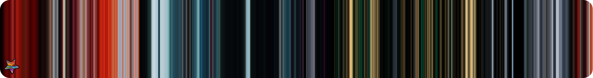
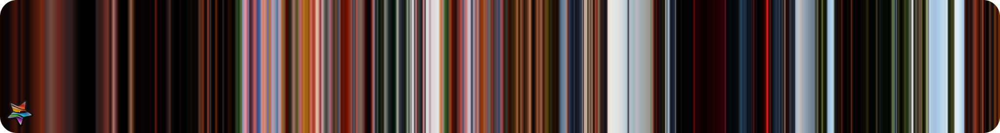
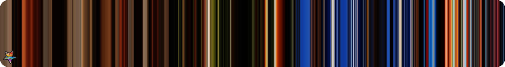

# F3H_LOCK_alexnardini_MultiVibrance_SHQ.json
- #### THIS FILE IS ONLY INFORMATIVE and part of the Documentations

 

- #### Quick links

  - **FLAM3H™** [**UI_ICON_map H19.0 to H20.0**](../../../src/F3H_UI_ICON_H19_to_H20.md)
  - **FLAM3H™** [**UI_ICON_map H20.5 to H22.0 UP**](../../../src/F3H_UI_ICON_H205_to_H22_UP.md)
  - **FLAM3H™** [**PY_PARM_map H19.0 to H20.0**](../../../src/F3H_PY_PARM_H19_to_H20.md)
  - **FLAM3H™** [**PY_PARM_map H20.5 to H22.0 UP**](../../../src/F3H_PY_PARM_H205_to_H22_UP.md)

   

  - **FLAM3H™USD** [**UI_ICON_map**](../../../src/F3HUSD_UI_ICON.md)
  - **FLAM3H™USD** [**PY_PARM_map H19 to H20**](../../../src/F3HUSD_PY_PARM_H19_to_H20.md)
  - **FLAM3H™USD** [**PY_PARM_map H20.5 to H22 UP**](../../../src/F3HUSD_PY_PARM_H205_to_H22_UP.md)

   

    - [**FULL ICON SET**](../../../icons/README.md)
    - [**PALETTE PREVIEWS**](../../../__FLAM3H_palette_libs/README.md)

   

    - [**FLAME PRESETS**](../../../__FLAM3H_flame_libs/README.md)

 
 
 
 

# Contents

 
 

- #   json
- ## File name: [**`F3H_LOCK_alexnardini_MultiVibrance_SHQ.json`**](../../F3H_LOCK_alexnardini_MultiVibrance_SHQ.json) _color keys_: **1024**
    1. - `MultiFrame_SHQ_01`  
    2. - `MultiFrame_SHQ_02`  
    3. - `MultiFrame_SHQ_03`  
    4. - `MultiFrame_SHQ_04`  
    5. - `MultiFrame_SHQ_05`  
    6. - `MultiFrame_SHQ_06`  
    7. - `MultiFrame_SHQ_07`  
    8. - `MultiFrame_SHQ_08`  
    9. - `MultiFrame_SHQ_09`  
    10. - `MultiFrame_SHQ_10`  
    11. - `MultiFrame_SHQ_11`  
    12. - `MultiFrame_SHQ_12`  
    13. - `MultiFrame_SHQ_13`  
    14. - `MultiFrame_SHQ_14`  
    15. - `MultiFrame_SHQ_15`  
    16. - `MultiFrame_SHQ_16`  
    17. - `MultiFrame_SHQ_17`  
    18. - `MultiFrame_SHQ_18`  
    19. - `MultiFrame_SHQ_19`  
    20. - `MultiFrame_SHQ_20`  

 
 
 
 

_Copyright (c) 2021 F stands for liFe_ 
