# F3H_LOCK_boxtail_pack_03_triangle.json
- #### THIS FILE IS ONLY INFORMATIVE and part of the Documentations

 

- #### Quick links

  - **FLAM3H™** [**UI_ICON_map H19.0 to H20.0**](../../../src/F3H_UI_ICON_H19_to_H20.md)
  - **FLAM3H™** [**UI_ICON_map H20.5 to H22.0 UP**](../../../src/F3H_UI_ICON_H205_to_H22_UP.md)
  - **FLAM3H™** [**PY_PARM_map H19.0 to H20.0**](../../../src/F3H_PY_PARM_H19_to_H20.md)
  - **FLAM3H™** [**PY_PARM_map H20.5 to H22.0 UP**](../../../src/F3H_PY_PARM_H205_to_H22_UP.md)

   

  - **FLAM3H™USD** [**UI_ICON_map**](../../../src/F3HUSD_UI_ICON.md)
  - **FLAM3H™USD** [**PY_PARM_map H19 to H20**](../../../src/F3HUSD_PY_PARM_H19_to_H20.md)
  - **FLAM3H™USD** [**PY_PARM_map H20.5 to H22 UP**](../../../src/F3HUSD_PY_PARM_H205_to_H22_UP.md)

   

    - [**FULL ICON SET**](../../../icons/README.md)
    - [**PALETTE PREVIEWS**](../../../__FLAM3H_palette_libs/README.md)

   

    - [**FLAME PRESETS**](../../../__FLAM3H_flame_libs/README.md)

 
 
 
 

# Contents

 
 

- #   json
- ## File name: [**`F3H_LOCK_boxtail_pack_03_triangle.json`**](../../F3H_LOCK_boxtail_pack_03_triangle.json) _color keys_: **256**
    1. - `At_corner` 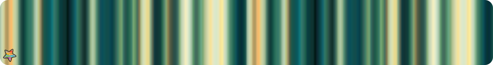
    2. - `Beam` 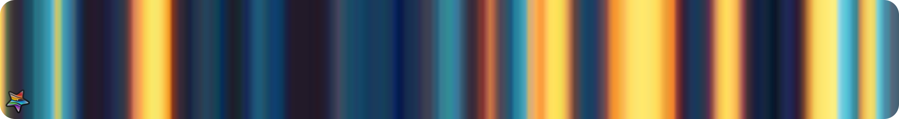 
    3. - `Blood_in_bathroom` 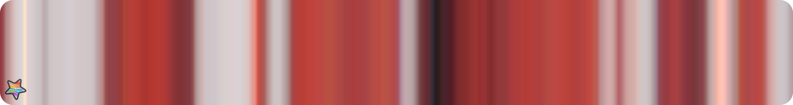 
    4. - `Bright_but_also_dark` 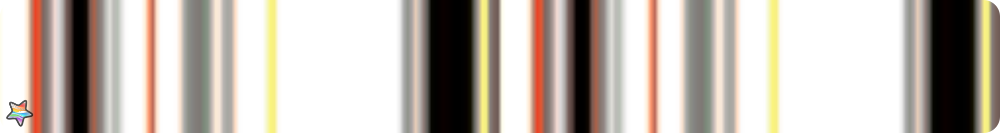 
    5. - `Chocolate`  
    6. - `Cold_again`  
    7. - `desudesu_err` 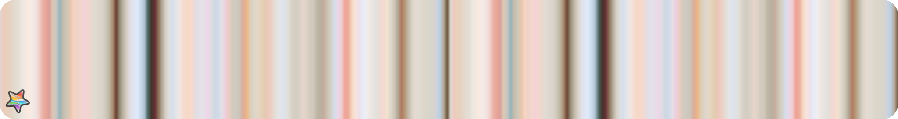 
    8. - `Fresh`  
    9. - `Garden_b` 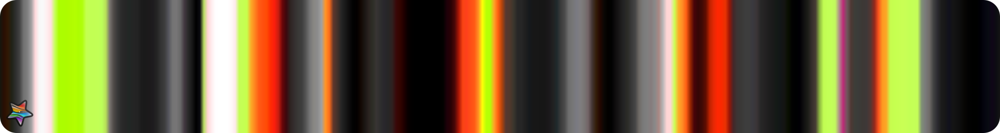 
    10. - `Hey_lets_go` 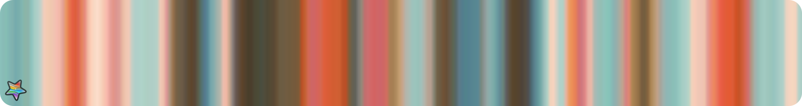 
    11. - `Hipster_cat` 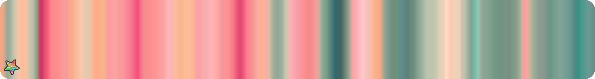 
    12. - `I_see_it_tehe` 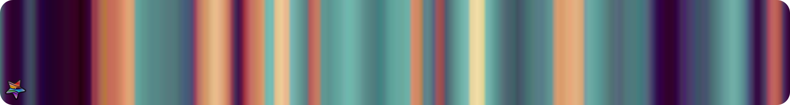 
    13. - `I_sit_and_wait` 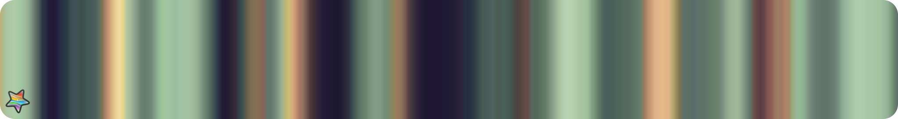 
    14. - `Just_cycling` 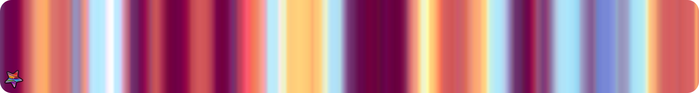 
    15. - `Kaamos` 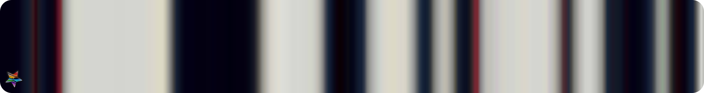 
    16. - `Kawaii_Cafe` 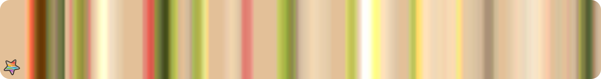 
    17. - `Lisardz` 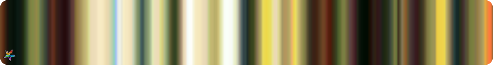 
    18. - `Looking_at_me` 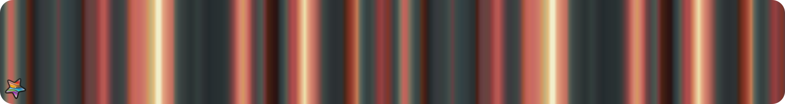 
    19. - `MELONS` 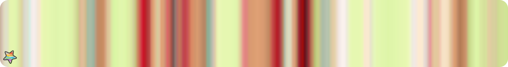 
    20. - `Nice_feet_you_got` 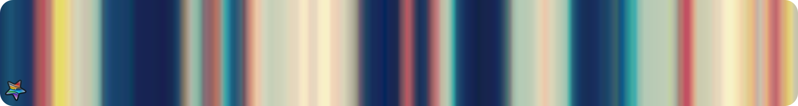 
    21. - `Obsidian`  
    22. - `Somewhat_blurry` 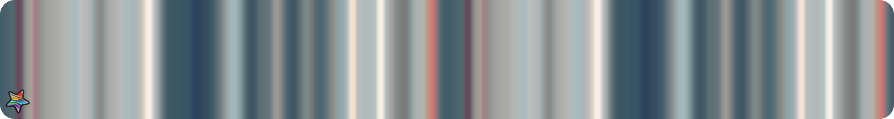 
    23. - `Sun_and_sea` 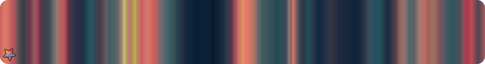 
    24. - `Take_them_off` 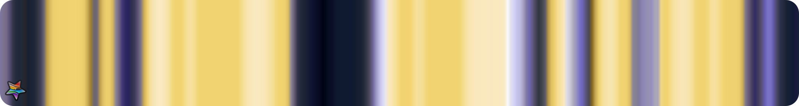 
    25. - `Teatable` 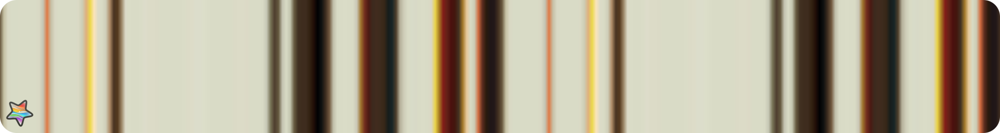 
    26. - `That_chinese_you_mentioned` 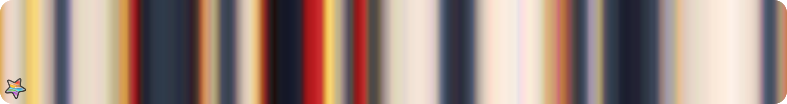 
    27. - `Tiger` 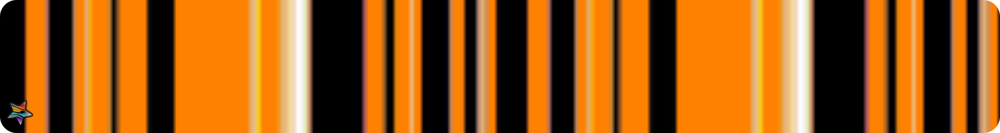 
    28. - `Underwear` 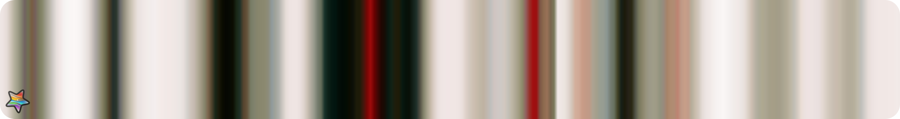 
    29. - `Werewolves_toilet` 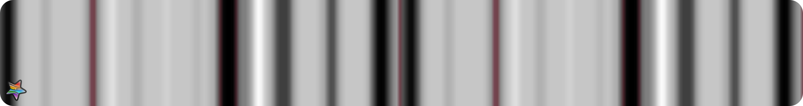 
    30. - `Yeo_thats_the_trick` 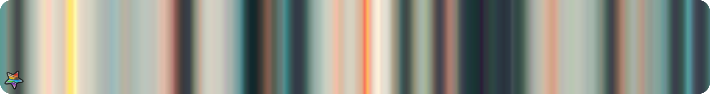 

 
 
 
 

_Copyright (c) 2021 F stands for liFe_ 
