# F3H_LOCK_fardareismai_pack_01_A.json
- #### THIS FILE IS ONLY INFORMATIVE and part of the Documentations

 

- #### Quick links

  - **FLAM3H™** [**UI_ICON_map H19.0 to H20.0**](../../../src/F3H_UI_ICON_H19_to_H20.md)
  - **FLAM3H™** [**UI_ICON_map H20.5 to H22.0 UP**](../../../src/F3H_UI_ICON_H205_to_H22_UP.md)
  - **FLAM3H™** [**PY_PARM_map H19.0 to H20.0**](../../../src/F3H_PY_PARM_H19_to_H20.md)
  - **FLAM3H™** [**PY_PARM_map H20.5 to H22.0 UP**](../../../src/F3H_PY_PARM_H205_to_H22_UP.md)

   

  - **FLAM3H™USD** [**UI_ICON_map**](../../../src/F3HUSD_UI_ICON.md)
  - **FLAM3H™USD** [**PY_PARM_map H19 to H20**](../../../src/F3HUSD_PY_PARM_H19_to_H20.md)
  - **FLAM3H™USD** [**PY_PARM_map H20.5 to H22 UP**](../../../src/F3HUSD_PY_PARM_H205_to_H22_UP.md)

   

    - [**FULL ICON SET**](../../../icons/README.md)
    - [**PALETTE PREVIEWS**](../../../__FLAM3H_palette_libs/README.md)

   

    - [**FLAME PRESETS**](../../../__FLAM3H_flame_libs/README.md)

 
 
 
 

# Contents

 
 

- #   json
- ## File name: [**`F3H_LOCK_fardareismai_pack_01_A.json`**](../../F3H_LOCK_fardareismai_pack_01_A.json) _color keys_: **256**
    1. - `a_really_pleasing_red_thing` [**`f3h_hex`**](https://github.com/alexnardini/FLAM3_for_SideFX_Houdini/blob/47b9fd38fcf0def532eba72d02d2eb11118d36c8/__FLAM3H_palette_libs/F3H_LOCK_fardareismai_pack_01_A.json#L2-L4) 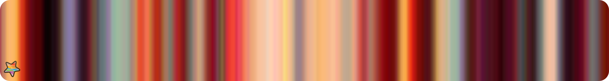 
    2. - `a_warm_dark_place` [**`f3h_hex`**](https://github.com/alexnardini/FLAM3_for_SideFX_Houdini/blob/47b9fd38fcf0def532eba72d02d2eb11118d36c8/__FLAM3H_palette_libs/F3H_LOCK_fardareismai_pack_01_A.json#L5-L7) 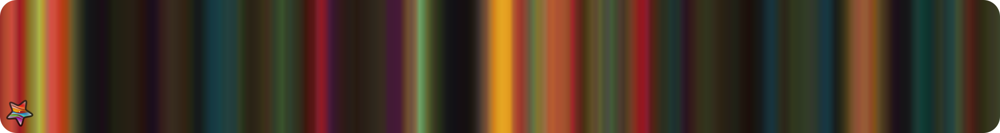 
    3. - `almost_all_sea_green` [**`f3h_hex`**](https://github.com/alexnardini/FLAM3_for_SideFX_Houdini/blob/47b9fd38fcf0def532eba72d02d2eb11118d36c8/__FLAM3H_palette_libs/F3H_LOCK_fardareismai_pack_01_A.json#L8-L10)  
    4. - `almost_too_classic` [**`f3h_hex`**](https://github.com/alexnardini/FLAM3_for_SideFX_Houdini/blob/47b9fd38fcf0def532eba72d02d2eb11118d36c8/__FLAM3H_palette_libs/F3H_LOCK_fardareismai_pack_01_A.json#L11-L13) 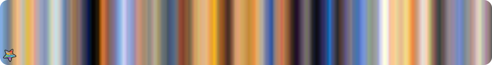 
    5. - `amber` [**`f3h_hex`**](https://github.com/alexnardini/FLAM3_for_SideFX_Houdini/blob/47b9fd38fcf0def532eba72d02d2eb11118d36c8/__FLAM3H_palette_libs/F3H_LOCK_fardareismai_pack_01_A.json#L14-L16)  
    6. - `amigo` [**`f3h_hex`**](https://github.com/alexnardini/FLAM3_for_SideFX_Houdini/blob/47b9fd38fcf0def532eba72d02d2eb11118d36c8/__FLAM3H_palette_libs/F3H_LOCK_fardareismai_pack_01_A.json#L17-L19) 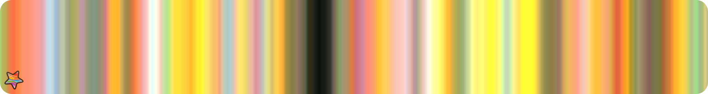 
    7. - `anime` [**`f3h_hex`**](https://github.com/alexnardini/FLAM3_for_SideFX_Houdini/blob/47b9fd38fcf0def532eba72d02d2eb11118d36c8/__FLAM3H_palette_libs/F3H_LOCK_fardareismai_pack_01_A.json#L20-L22) 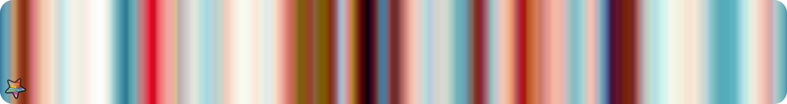 
    8. - `arthropod_colors` [**`f3h_hex`**](https://github.com/alexnardini/FLAM3_for_SideFX_Houdini/blob/47b9fd38fcf0def532eba72d02d2eb11118d36c8/__FLAM3H_palette_libs/F3H_LOCK_fardareismai_pack_01_A.json#L23-L25) 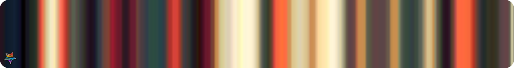 
    9. - `backlit` [**`f3h_hex`**](https://github.com/alexnardini/FLAM3_for_SideFX_Houdini/blob/47b9fd38fcf0def532eba72d02d2eb11118d36c8/__FLAM3H_palette_libs/F3H_LOCK_fardareismai_pack_01_A.json#L26-L28) 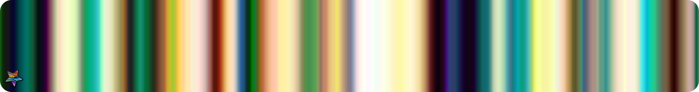 
    10. - `barton` [**`f3h_hex`**](https://github.com/alexnardini/FLAM3_for_SideFX_Houdini/blob/47b9fd38fcf0def532eba72d02d2eb11118d36c8/__FLAM3H_palette_libs/F3H_LOCK_fardareismai_pack_01_A.json#L29-L31) 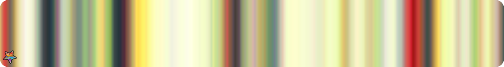 
    11. - `barton_contrast` [**`f3h_hex`**](https://github.com/alexnardini/FLAM3_for_SideFX_Houdini/blob/47b9fd38fcf0def532eba72d02d2eb11118d36c8/__FLAM3H_palette_libs/F3H_LOCK_fardareismai_pack_01_A.json#L32-L34) 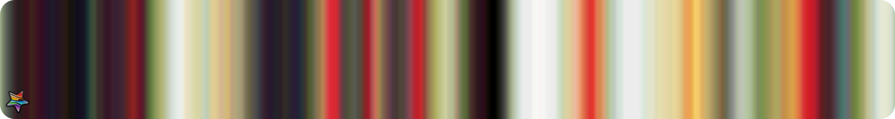 
    12. - `beautiful_overexposure` [**`f3h_hex`**](https://github.com/alexnardini/FLAM3_for_SideFX_Houdini/blob/47b9fd38fcf0def532eba72d02d2eb11118d36c8/__FLAM3H_palette_libs/F3H_LOCK_fardareismai_pack_01_A.json#L35-L37) 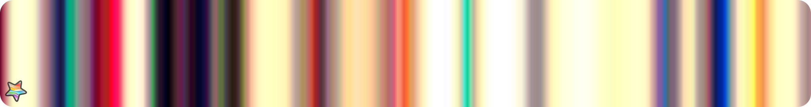 
    13. - `beige_and_grey` [**`f3h_hex`**](https://github.com/alexnardini/FLAM3_for_SideFX_Houdini/blob/47b9fd38fcf0def532eba72d02d2eb11118d36c8/__FLAM3H_palette_libs/F3H_LOCK_fardareismai_pack_01_A.json#L38-L40) 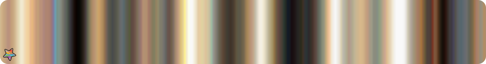 
    14. - `bioluminescence` [**`f3h_hex`**](https://github.com/alexnardini/FLAM3_for_SideFX_Houdini/blob/47b9fd38fcf0def532eba72d02d2eb11118d36c8/__FLAM3H_palette_libs/F3H_LOCK_fardareismai_pack_01_A.json#L41-L43)  
    15. - `blue_green_orange` [**`f3h_hex`**](https://github.com/alexnardini/FLAM3_for_SideFX_Houdini/blob/47b9fd38fcf0def532eba72d02d2eb11118d36c8/__FLAM3H_palette_libs/F3H_LOCK_fardareismai_pack_01_A.json#L44-L46)  
    16. - `blue_orange_and_creamy` [**`f3h_hex`**](https://github.com/alexnardini/FLAM3_for_SideFX_Houdini/blob/47b9fd38fcf0def532eba72d02d2eb11118d36c8/__FLAM3H_palette_libs/F3H_LOCK_fardareismai_pack_01_A.json#L47-L49)  
    17. - `blue_white_pink` [**`f3h_hex`**](https://github.com/alexnardini/FLAM3_for_SideFX_Houdini/blob/47b9fd38fcf0def532eba72d02d2eb11118d36c8/__FLAM3H_palette_libs/F3H_LOCK_fardareismai_pack_01_A.json#L50-L52)  
    18. - `blue_and_dark_salmon` [**`f3h_hex`**](https://github.com/alexnardini/FLAM3_for_SideFX_Houdini/blob/47b9fd38fcf0def532eba72d02d2eb11118d36c8/__FLAM3H_palette_libs/F3H_LOCK_fardareismai_pack_01_A.json#L53-L55) 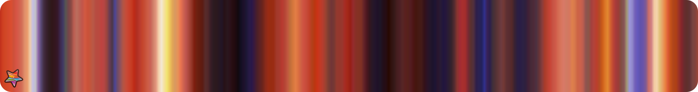 
    19. - `blue_and_dust` [**`f3h_hex`**](https://github.com/alexnardini/FLAM3_for_SideFX_Houdini/blob/47b9fd38fcf0def532eba72d02d2eb11118d36c8/__FLAM3H_palette_libs/F3H_LOCK_fardareismai_pack_01_A.json#L56-L58)  
    20. - `blue_and_green` [**`f3h_hex`**](https://github.com/alexnardini/FLAM3_for_SideFX_Houdini/blob/47b9fd38fcf0def532eba72d02d2eb11118d36c8/__FLAM3H_palette_libs/F3H_LOCK_fardareismai_pack_01_A.json#L59-L61) 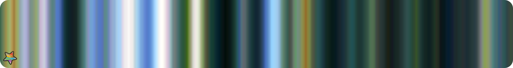 
    21. - `blue_and_orange_b` [**`f3h_hex`**](https://github.com/alexnardini/FLAM3_for_SideFX_Houdini/blob/47b9fd38fcf0def532eba72d02d2eb11118d36c8/__FLAM3H_palette_libs/F3H_LOCK_fardareismai_pack_01_A.json#L62-L64) 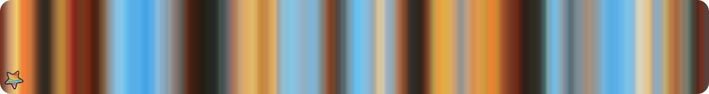 
    22. - `blue_and_red` [**`f3h_hex`**](https://github.com/alexnardini/FLAM3_for_SideFX_Houdini/blob/47b9fd38fcf0def532eba72d02d2eb11118d36c8/__FLAM3H_palette_libs/F3H_LOCK_fardareismai_pack_01_A.json#L65-L67) 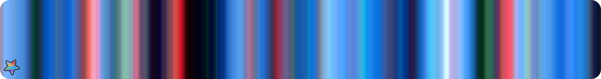 
    23. - `cadet_and_cream` [**`f3h_hex`**](https://github.com/alexnardini/FLAM3_for_SideFX_Houdini/blob/47b9fd38fcf0def532eba72d02d2eb11118d36c8/__FLAM3H_palette_libs/F3H_LOCK_fardareismai_pack_01_A.json#L68-L70) 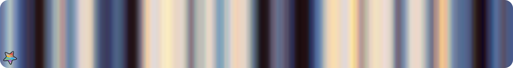 
    24. - `cadet_and_olive` [**`f3h_hex`**](https://github.com/alexnardini/FLAM3_for_SideFX_Houdini/blob/47b9fd38fcf0def532eba72d02d2eb11118d36c8/__FLAM3H_palette_libs/F3H_LOCK_fardareismai_pack_01_A.json#L71-L73)  
    25. - `cadet_and_orange` [**`f3h_hex`**](https://github.com/alexnardini/FLAM3_for_SideFX_Houdini/blob/47b9fd38fcf0def532eba72d02d2eb11118d36c8/__FLAM3H_palette_libs/F3H_LOCK_fardareismai_pack_01_A.json#L74-L76) 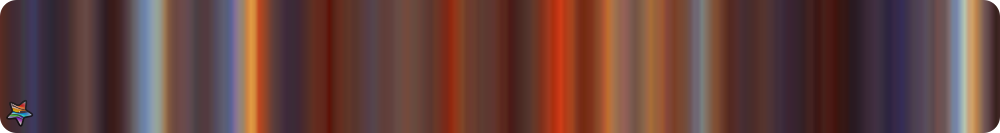 
    26. - `cadet_and_red` [**`f3h_hex`**](https://github.com/alexnardini/FLAM3_for_SideFX_Houdini/blob/47b9fd38fcf0def532eba72d02d2eb11118d36c8/__FLAM3H_palette_libs/F3H_LOCK_fardareismai_pack_01_A.json#L77-L79)  
    27. - `cave_crystals` [**`f3h_hex`**](https://github.com/alexnardini/FLAM3_for_SideFX_Houdini/blob/47b9fd38fcf0def532eba72d02d2eb11118d36c8/__FLAM3H_palette_libs/F3H_LOCK_fardareismai_pack_01_A.json#L80-L82)  
    28. - `cave_flashlights` [**`f3h_hex`**](https://github.com/alexnardini/FLAM3_for_SideFX_Houdini/blob/47b9fd38fcf0def532eba72d02d2eb11118d36c8/__FLAM3H_palette_libs/F3H_LOCK_fardareismai_pack_01_A.json#L83-L85)  
    29. - `city` [**`f3h_hex`**](https://github.com/alexnardini/FLAM3_for_SideFX_Houdini/blob/47b9fd38fcf0def532eba72d02d2eb11118d36c8/__FLAM3H_palette_libs/F3H_LOCK_fardareismai_pack_01_A.json#L86-L88)  
    30. - `city_at_night` [**`f3h_hex`**](https://github.com/alexnardini/FLAM3_for_SideFX_Houdini/blob/47b9fd38fcf0def532eba72d02d2eb11118d36c8/__FLAM3H_palette_libs/F3H_LOCK_fardareismai_pack_01_A.json#L89-L91) 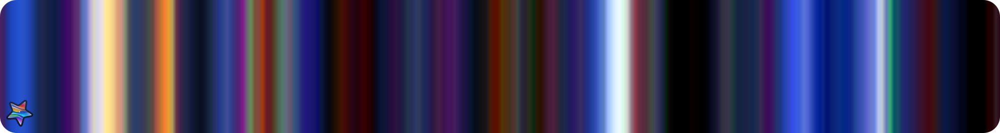 
    31. - `clouds_and_icecream` [**`f3h_hex`**](https://github.com/alexnardini/FLAM3_for_SideFX_Houdini/blob/47b9fd38fcf0def532eba72d02d2eb11118d36c8/__FLAM3H_palette_libs/F3H_LOCK_fardareismai_pack_01_A.json#L92-L94) 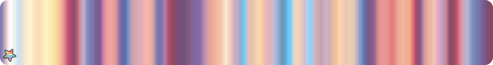 
    32. - `cyan_sienna_black` [**`f3h_hex`**](https://github.com/alexnardini/FLAM3_for_SideFX_Houdini/blob/47b9fd38fcf0def532eba72d02d2eb11118d36c8/__FLAM3H_palette_libs/F3H_LOCK_fardareismai_pack_01_A.json#L95-L97) 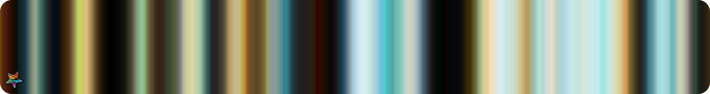 
    33. - `cyan_goes_with_everything` [**`f3h_hex`**](https://github.com/alexnardini/FLAM3_for_SideFX_Houdini/blob/47b9fd38fcf0def532eba72d02d2eb11118d36c8/__FLAM3H_palette_libs/F3H_LOCK_fardareismai_pack_01_A.json#L98-L100) 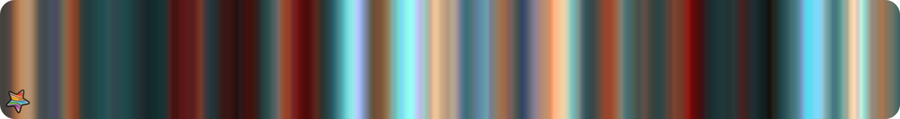 
    34. - `dark_blue_with_gold_and_orange` [**`f3h_hex`**](https://github.com/alexnardini/FLAM3_for_SideFX_Houdini/blob/47b9fd38fcf0def532eba72d02d2eb11118d36c8/__FLAM3H_palette_libs/F3H_LOCK_fardareismai_pack_01_A.json#L101-L103) 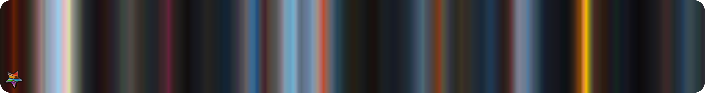 
    35. - `desaturated_midtones` [**`f3h_hex`**](https://github.com/alexnardini/FLAM3_for_SideFX_Houdini/blob/47b9fd38fcf0def532eba72d02d2eb11118d36c8/__FLAM3H_palette_libs/F3H_LOCK_fardareismai_pack_01_A.json#L104-L106) 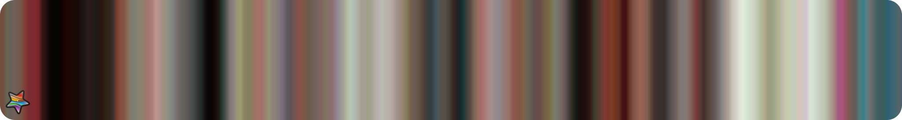 
    36. - `desaturated_with_red` [**`f3h_hex`**](https://github.com/alexnardini/FLAM3_for_SideFX_Houdini/blob/47b9fd38fcf0def532eba72d02d2eb11118d36c8/__FLAM3H_palette_libs/F3H_LOCK_fardareismai_pack_01_A.json#L107-L109) 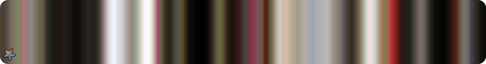 
    37. - `disney_polaroid` [**`f3h_hex`**](https://github.com/alexnardini/FLAM3_for_SideFX_Houdini/blob/47b9fd38fcf0def532eba72d02d2eb11118d36c8/__FLAM3H_palette_libs/F3H_LOCK_fardareismai_pack_01_A.json#L110-L112)  
    38. - `dusty_rose_and_lavander` [**`f3h_hex`**](https://github.com/alexnardini/FLAM3_for_SideFX_Houdini/blob/47b9fd38fcf0def532eba72d02d2eb11118d36c8/__FLAM3H_palette_libs/F3H_LOCK_fardareismai_pack_01_A.json#L113-L115) 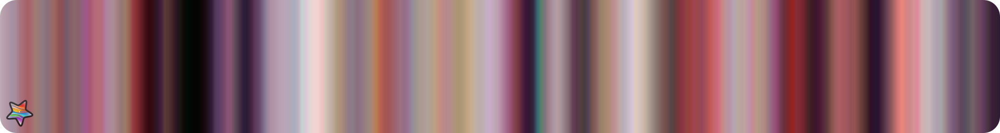 
    39. - `florence` [**`f3h_hex`**](https://github.com/alexnardini/FLAM3_for_SideFX_Houdini/blob/47b9fd38fcf0def532eba72d02d2eb11118d36c8/__FLAM3H_palette_libs/F3H_LOCK_fardareismai_pack_01_A.json#L116-L118)  
    40. - `fuchsia_and_gold` [**`f3h_hex`**](https://github.com/alexnardini/FLAM3_for_SideFX_Houdini/blob/47b9fd38fcf0def532eba72d02d2eb11118d36c8/__FLAM3H_palette_libs/F3H_LOCK_fardareismai_pack_01_A.json#L119-L121) 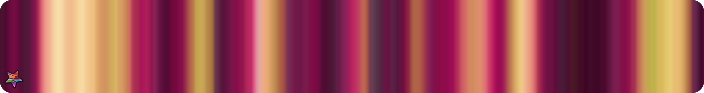 
    41. - `fuck_yeah_rainbows` [**`f3h_hex`**](https://github.com/alexnardini/FLAM3_for_SideFX_Houdini/blob/47b9fd38fcf0def532eba72d02d2eb11118d36c8/__FLAM3H_palette_libs/F3H_LOCK_fardareismai_pack_01_A.json#L122-L124) 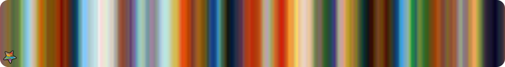 
    42. - `gold_and_cyan` [**`f3h_hex`**](https://github.com/alexnardini/FLAM3_for_SideFX_Houdini/blob/47b9fd38fcf0def532eba72d02d2eb11118d36c8/__FLAM3H_palette_libs/F3H_LOCK_fardareismai_pack_01_A.json#L125-L127)  
    43. - `grey_salmon_cyan` [**`f3h_hex`**](https://github.com/alexnardini/FLAM3_for_SideFX_Houdini/blob/47b9fd38fcf0def532eba72d02d2eb11118d36c8/__FLAM3H_palette_libs/F3H_LOCK_fardareismai_pack_01_A.json#L128-L130) 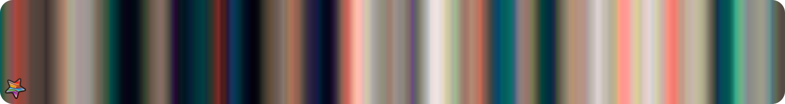 

 
 
 
 

_Copyright (c) 2021 F stands for liFe_ 
