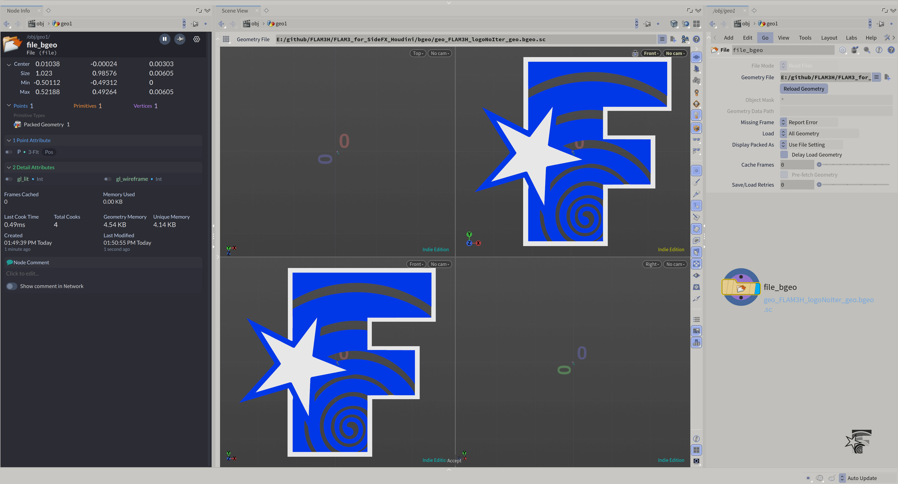
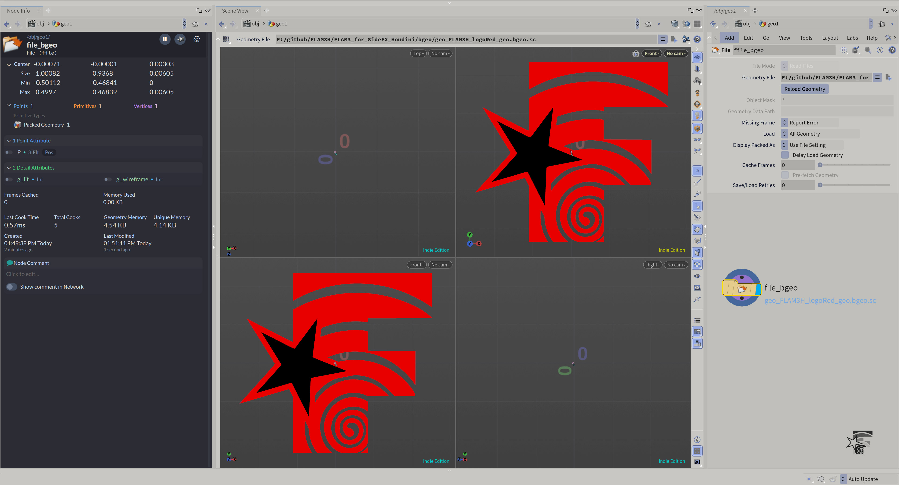
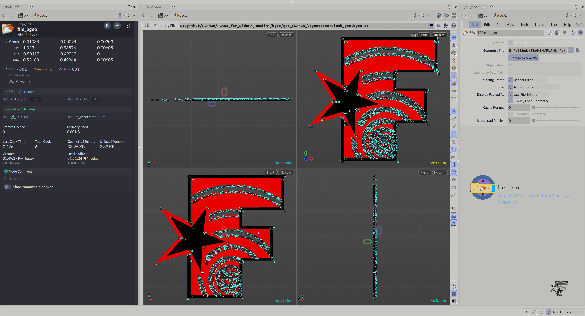
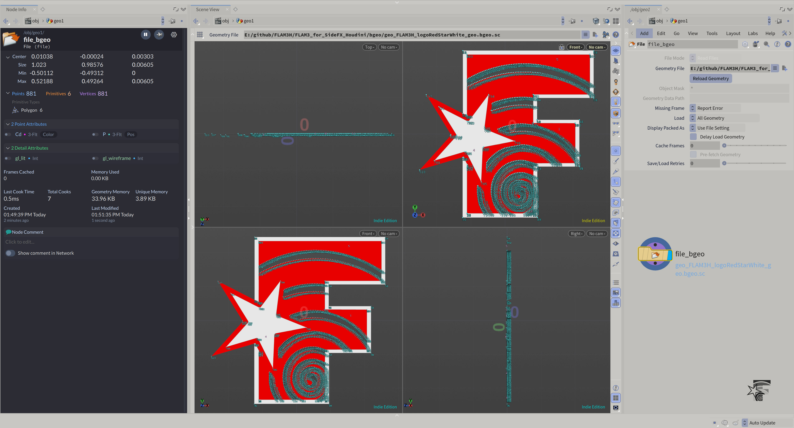
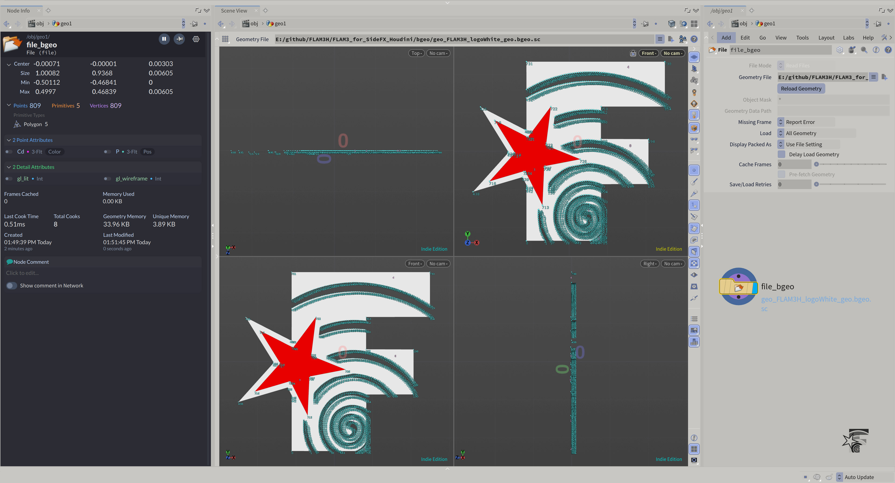
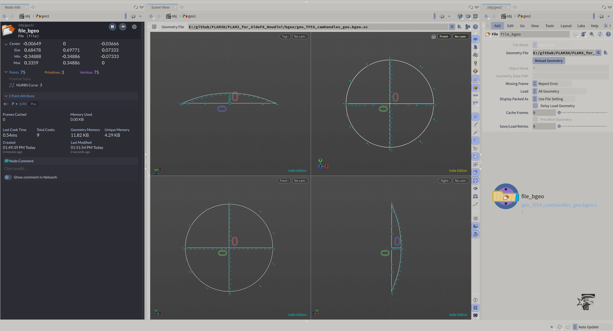
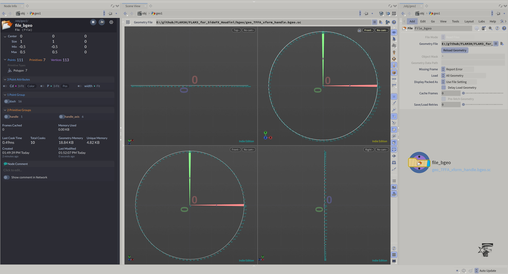
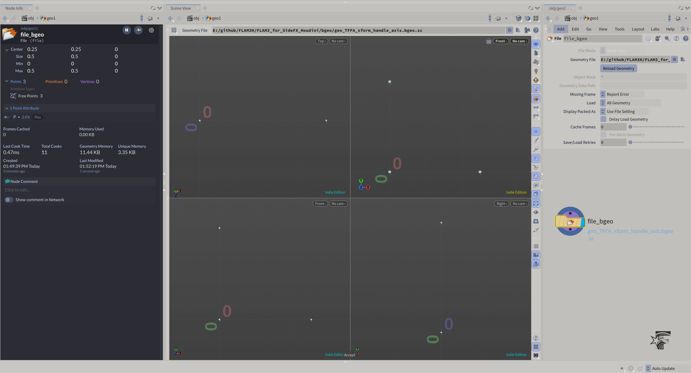
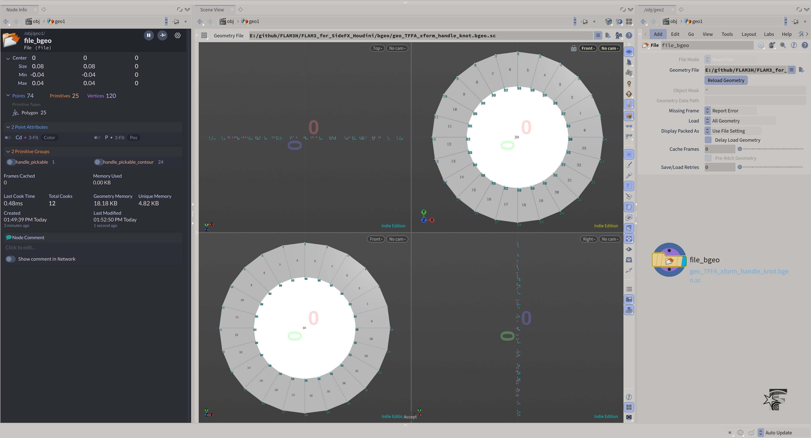

### FLAM3H™ HDA geo ###

Those files are the **FLAM3H™** HDA utility geometries.</br>
They are already embedded inside the HDA and are used on different occasions across the FLAM3H™ functionalities.

Available in this repository for easy edit and review.

</br>
</br>

# Contents

Following are preview images for each bgeo geometry file.<br />
They include a node info window (_left panel_) for all related details/informations.


</br>
</br>
</br>
</br>


<p align="center">
  </p>
<b><p align="center">geo_FLAM3H_logoNoIter_geo.jpg</b>
<p align="center">......</p>
<p align="center">

<b>GITHUB</b>

```
https://github.com/alexnardini/FLAM3_for_SideFX_Houdini/blob/main/bgeo/bgeo_preview/geo_FLAM3H_logoNoIter_geo.jpg
```
<p align="center">...</p></br/></br/></br/></br/>


<p align="center">
  </p>
<b><p align="center">geo_FLAM3H_logoRed_geo.jpg</b>
<p align="center">......</p>
<p align="center">

<b>GITHUB</b>

```
https://github.com/alexnardini/FLAM3_for_SideFX_Houdini/blob/main/bgeo/bgeo_preview/geo_FLAM3H_logoRed_geo.jpg
```
<p align="center">...</p></br/></br/></br/></br/>


<p align="center">
  </p>
<b><p align="center">geo_FLAM3H_logoRedStarBlack_geo.jpg</b>
<p align="center">......</p>
<p align="center">

<b>GITHUB</b>

```
https://github.com/alexnardini/FLAM3_for_SideFX_Houdini/blob/main/bgeo/bgeo_preview/geo_FLAM3H_logoRedStarBlack_geo.jpg
```
<p align="center">...</p></br/></br/></br/></br/>


<p align="center">
  </p>
<b><p align="center">geo_FLAM3H_logoRedStarWhite_geo.jpg</b>
<p align="center">......</p>
<p align="center">

<b>GITHUB</b>

```
https://github.com/alexnardini/FLAM3_for_SideFX_Houdini/blob/main/bgeo/bgeo_preview/geo_FLAM3H_logoRedStarWhite_geo.jpg
```
<p align="center">...</p></br/></br/></br/></br/>


<p align="center">
  </p>
<b><p align="center">geo_FLAM3H_logoWhite_geo.jpg</b> (<i>Not used</i>)
<p align="center">......</p>
<p align="center">

<b>GITHUB</b>

```
https://github.com/alexnardini/FLAM3_for_SideFX_Houdini/blob/main/bgeo/bgeo_preview/geo_FLAM3H_logoWhite_geo.jpg
```
<p align="center">...</p></br/></br/></br/></br/>


<p align="center">
  </p>
<b><p align="center">geo_TFFA_camhandles_geo.jpg</b>
<p align="center">......</p>
<p align="center">

<b>GITHUB</b>

```
https://github.com/alexnardini/FLAM3_for_SideFX_Houdini/blob/main/bgeo/bgeo_preview/geo_TFFA_camhandles_geo.jpg
```
<p align="center">...</p></br/></br/></br/></br/>


<p align="center">
  </p>
<b><p align="center">geo_TFFA_xform_handle.jpg</b>
<p align="center">......</p>
<p align="center">

<b>GITHUB</b>

```
https://github.com/alexnardini/FLAM3_for_SideFX_Houdini/blob/main/bgeo/bgeo_preview/geo_TFFA_xform_handle.jpg
```
<p align="center">...</p></br/></br/></br/></br/>


<p align="center">
  </p>
<b><p align="center">geo_TFFA_xform_handle_axis.jpg</b>
<p align="center">......</p>
<p align="center">

<b>GITHUB</b>

```
https://github.com/alexnardini/FLAM3_for_SideFX_Houdini/blob/main/bgeo/bgeo_preview/geo_TFFA_xform_handle_axis.jpg
```
<p align="center">...</p></br/></br/></br/></br/>


<p align="center">
  </p>
<b><p align="center">geo_TFFA_xform_handle_knot.jpg</b>
<p align="center">......</p>
<p align="center">

<b>GITHUB</b>

```
https://github.com/alexnardini/FLAM3_for_SideFX_Houdini/blob/main/bgeo/bgeo_preview/geo_TFFA_xform_handle_knot.jpg
```
<p align="center">...</p></br/></br/></br/></br/>

<br/>
<br/>
<br/>
<br/>

_Copyright (c) 2021 F stands for liFe_<br/>
