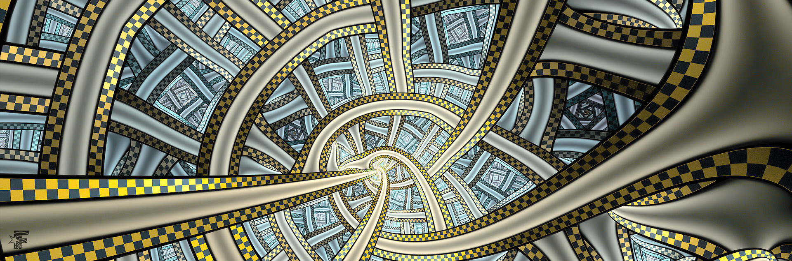
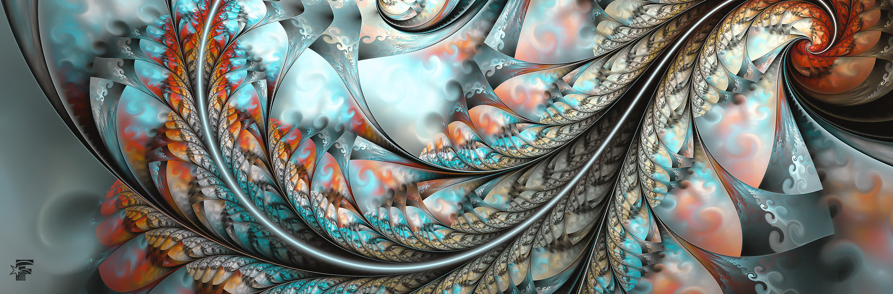
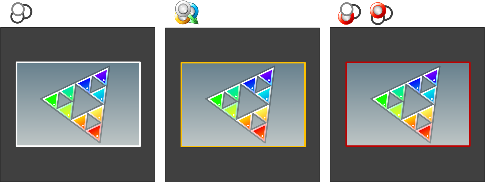
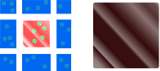
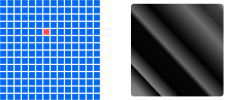
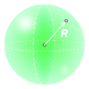
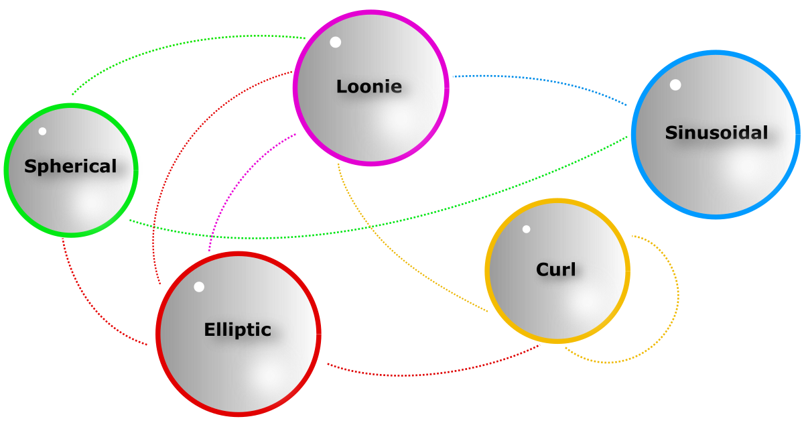
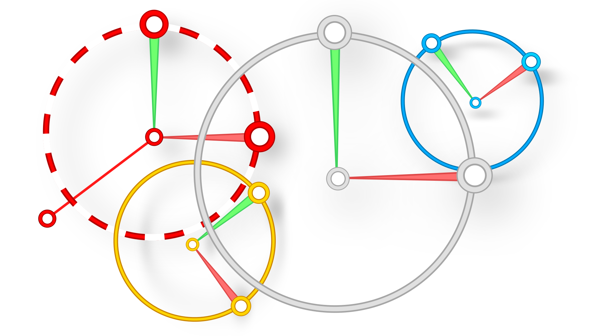

# FLAM3H™ (and FLAM3H™USD) DOC image set #
- #### THIS FILE IS ONLY INFORMATIVE and part of the Documentations

</br>

- #### Quick links

  - **FLAM3H™** [**UI_ICON_map H19.0 to H20.0**](../../src/F3H_UI_ICON_H19_to_H20.md)
  - **FLAM3H™** [**UI_ICON_map H20.5 to H22.0 UP**](../../src/F3H_UI_ICON_H205_to_H22_UP.md)
  - **FLAM3H™** [**PY_PARM_map H19.0 to H20.0**](../../src/F3H_PY_PARM_H19_to_H20.md)
  - **FLAM3H™** [**PY_PARM_map H20.5 to H22.0 UP**](../../src/F3H_PY_PARM_H205_to_H22_UP.md)

  </br>

  - **FLAM3H™USD** [**UI_ICON_map**](../../src/F3HUSD_UI_ICON.md)
  - **FLAM3H™USD** [**PY_PARM_map H19 to H20**](../../src/F3HUSD_PY_PARM_H19_to_H20.md)
  - **FLAM3H™USD** [**PY_PARM_map H20.5 to H22 UP**](../../src/F3HUSD_PY_PARM_H205_to_H22_UP.md)

  </br>

    - [**FULL ICON SET**](../../icons/README.md)
    - [**PALETTE PREVIEWS**](../../__FLAM3H_palette_libs/README.md)

  </br>

    - [**FLAME PRESETS**](../../__FLAM3H_flame_libs/README.md)

<br>
<br>
<br>
<br>

# Contents

The following images are used for illustration purposes inside the HDAs documentations.

</br>
</br>
</br>
</br>


<p align="center">
  </p>
<b><p align="center">FLAM3H_DOC_intro_H220.svg</b><br/><i>Renamed as <u>FLAM3H_DOC_intro.jpg</u> once uploaded into the HDA</i>.</p>
<p align="center">......</p>
<p align="center">

<b>Image</b>

```
[Image:opdef:.?FLAM3H_DOC_intro_H220.jpg]
```
<b>GITHUB</b>

```
https://github.com/alexnardini/FLAM3_for_SideFX_Houdini/blob/main/icons/hda_doc/FLAM3H_DOC_intro_H220.jpg
```
<p align="center">...</p></br/></br/></br/></br/>


<p align="center">
  </p>
<b><p align="center">FLAM3H_DOC_intro_H205.svg</b><br/><i>Renamed as <u>FLAM3H_DOC_intro.jpg</u> once uploaded into the HDA</i>.</p>
<p align="center">......</p>
<p align="center">

<b>Image</b>

```
[Image:opdef:.?FLAM3H_DOC_intro_H205.jpg]
```
<b>GITHUB</b>

```
https://github.com/alexnardini/FLAM3_for_SideFX_Houdini/blob/main/icons/hda_doc/FLAM3H_DOC_intro_H205.jpg
```
<p align="center">...</p></br/></br/></br/></br/>


<p align="center">
  </p>
<b><p align="center">FLAM3H_DOC_intro_H190.svg</b><br/><i>Renamed as <u>FLAM3H_DOC_intro.jpg</u> once uploaded into the HDA</i>.</p>
<p align="center">......</p>
<p align="center">

<b>Image</b>

```
[Image:opdef:.?FLAM3H_DOC_intro_H190.jpg]
```
<b>GITHUB</b>

```
https://github.com/alexnardini/FLAM3_for_SideFX_Houdini/blob/main/icons/hda_doc/FLAM3H_DOC_intro_H190.jpg
```
<p align="center">...</p></br/></br/></br/></br/>


<p align="center">
  </p>
<b><p align="center">FLAM3HUSD_DOC_intro_H190.svg</b><br/><i>Renamed as <u>FLAM3H_DOC_intro.jpg</u> once uploaded into the HDA</i>.</p>
<p align="center">......</p>
<p align="center">

<b>Image</b>

```
[Image:opdef:.?FLAM3HUSD_DOC_intro_H190.jpg]
```
<b>GITHUB</b>

```
https://github.com/alexnardini/FLAM3_for_SideFX_Houdini/blob/main/icons/hda_doc/FLAM3HUSD_DOC_intro_H190.jpg
```
<p align="center">...</p></br/></br/></br/></br/>


<p align="center">
  </p>
<b><p align="center">FLAM3H_DOC_camera_sensor_outline.svg</p></b>
<p align="center">......</p>
<p align="center">

<b>Image</b>

```
[Image:opdef:.?FLAM3H_DOC_camera_sensor_outline.svg]
```
<b>GITHUB</b>

```
https://github.com/alexnardini/FLAM3_for_SideFX_Houdini/blob/main/icons/hda_doc/FLAM3H_DOC_camera_sensor_outline.svg
```
<p align="center">...</p></br/></br/></br/></br/>


<p align="center">
  </p>
<b><p align="center">FLAM3H_DOC_pixel_fill.svg</p></b>
<p align="center">......</p>
<p align="center">

<b>Image</b>

```
[Image:opdef:.?FLAM3H_DOC_pixel_fill.svg]
```
<b>GITHUB</b>

```
https://github.com/alexnardini/FLAM3_for_SideFX_Houdini/blob/main/icons/hda_doc/FLAM3H_DOC_pixel_fill.svg
```
<p align="center">...</p></br/></br/></br/></br/>


<p align="center">
  </p>
<b><p align="center">FLAM3H_DOC_pixel_view.svg</p></b>
<p align="center">......</p>
<p align="center">

<b>Image</b>

```
[Image:opdef:.?FLAM3H_DOC_pixel_view.svg]
```
<b>GITHUB</b>

```
https://github.com/alexnardini/FLAM3_for_SideFX_Houdini/blob/main/icons/hda_doc/FLAM3H_DOC_pixel_view.svg
```
<p align="center">...</p></br/></br/></br/></br/>


<p align="center">
  </p>
<b><p align="center">FLAM3H_DOC_pixels_grid.svg</p></b>
<p align="center">......</p>
<p align="center">

<b>Image</b>

```
[Image:opdef:.?FLAM3H_DOC_pixels_grid.svg]
```
<b>GITHUB</b>

```
https://github.com/alexnardini/FLAM3_for_SideFX_Houdini/blob/main/icons/hda_doc/FLAM3H_DOC_pixels_grid.svg
```
<p align="center">...</p></br/></br/></br/></br/>


<p align="center">
  </p>
<b><p align="center">FLAM3H_DOC_point_dimension.svg</p></b>
<p align="center">......</p>
<p align="center">

<b>Image</b>

```
[Image:opdef:.?FLAM3H_DOC_point_dimension.svg]
```
<b>GITHUB</b>

```
https://github.com/alexnardini/FLAM3_for_SideFX_Houdini/blob/main/icons/hda_doc/FLAM3H_DOC_point_dimension.svg
```
<p align="center">...</p></br/></br/></br/></br/>


<p align="center">
  </p>
<b><p align="center">FLAM3H_DOC_tag.svg</p></b>
<p align="center">......</p>
<p align="center">

<b>Image</b>

```
[Image:opdef:.?FLAM3H_DOC_tag.svg]
```
<b>GITHUB</b>

```
https://github.com/alexnardini/FLAM3_for_SideFX_Houdini/blob/main/icons/hda_doc/FLAM3H_DOC_tag.svg
```
<p align="center">...</p></br/></br/></br/></br/>


<p align="center">
  </p>
<b><p align="center">FLAM3H_DOC_xaos_pathsSVG.svg</p></b>
<p align="center">......</p>
<p align="center">

<b>Image</b>

```
[Image:opdef:.?FLAM3H_DOC_xaos_pathsSVG.svg]
```
<b>GITHUB</b>

```
https://github.com/alexnardini/FLAM3_for_SideFX_Houdini/blob/main/icons/hda_doc/FLAM3H_DOC_xaos_pathsSVG.svg
```
<p align="center">...</p></br/></br/></br/></br/>


<p align="center">
  </p>
<b><p align="center">FLAM3H_DOC_xforms_handles.svg</p></b>
<p align="center">......</p>
<p align="center">

<b>Image</b>

```
[Image:opdef:.?FLAM3H_DOC_xforms_handles.svg]
```
<b>GITHUB</b>

```
https://github.com/alexnardini/FLAM3_for_SideFX_Houdini/blob/main/icons/hda_doc/FLAM3H_DOC_xforms_handles.svg
```
<p align="center">...</p></br/></br/></br/></br/>


<br/>
<br/>
<br/>
<br/>

_Copyright (c) 2021 F stands for liFe_<br/>
