## Github repo miscellaneous images ###

Those images are used throughout this repository for illustration purposes.</br>
( _Mainly inside the Github repo README.md file_ ).

</br>
</br>

# Contents

</br>
</br>
</br>
</br>


<p align="center"><i>Ieddaka Gnarl - author: zuek</i></p>
<p align="center">
  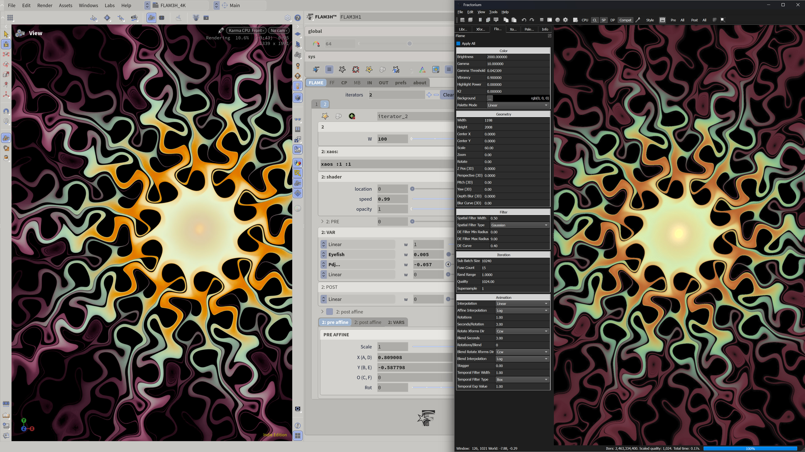</p>
<b><p align="center">ChaoticaToFLAM3HOUDINI_00.jpg</b>
<p align="center">......</p>
<p align="center">

<b>GITHUB</b>

```
https://github.com/alexnardini/FLAM3_for_SideFX_Houdini/blob/main/icons/hda_doc/ChaoticaToFLAM3HOUDINI_00.jpg
```
<p align="center">...</p></br/></br/></br/></br/>


<p align="center"><i>Blue Modulus - author: tatasz</i></p>
<p align="center">
  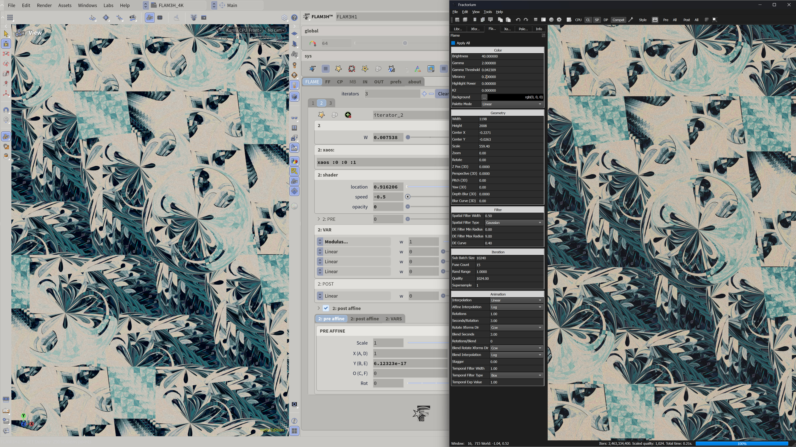</p>
<b><p align="center">ChaoticaToFLAM3HOUDINI_01.jpg</b>
<p align="center">......</p>
<p align="center">

<b>GITHUB</b>

```
https://github.com/alexnardini/FLAM3_for_SideFX_Houdini/blob/main/icons/hda_doc/ChaoticaToFLAM3HOUDINI_01.jpg
```
<p align="center">...</p></br/></br/></br/></br/>


<p align="center"><i>Lazyswirls - author: meckie</i></p>
<p align="center">
  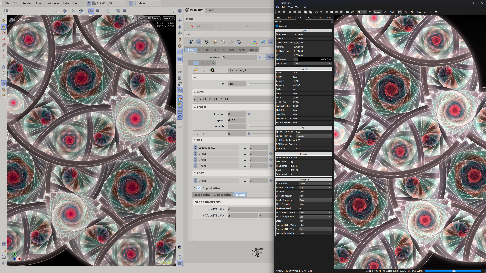</p>
<b><p align="center">ChaoticaToFLAM3HOUDINI_02.jpg</b>
<p align="center">......</p>
<p align="center">

<b>GITHUB</b>

```
https://github.com/alexnardini/FLAM3_for_SideFX_Houdini/blob/main/icons/hda_doc/ChaoticaToFLAM3HOUDINI_02.jpg
```
<p align="center">...</p></br/></br/></br/></br/>


<p align="center"><i>Majestic - author: tatasz</i></p>
<p align="center">
  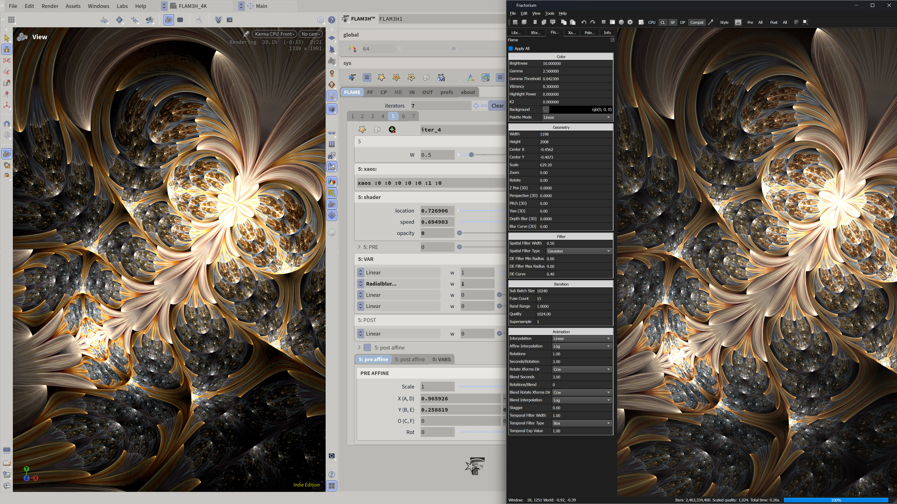</p>
<b><p align="center">ChaoticaToFLAM3HOUDINI_03.jpg</b>
<p align="center">......</p>
<p align="center">

<b>GITHUB</b>

```
https://github.com/alexnardini/FLAM3_for_SideFX_Houdini/blob/main/icons/hda_doc/ChaoticaToFLAM3HOUDINI_03.jpg
```
<p align="center">...</p></br/></br/></br/></br/>


<p align="center"><i>Blurry Splits - author: tatasz</i></p>
<p align="center">
  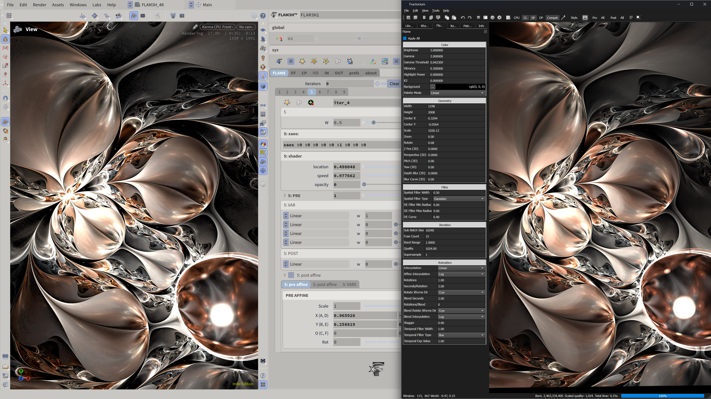</p>
<b><p align="center">ChaoticaToFLAM3HOUDINI_04.jpg</b>
<p align="center">......</p>
<p align="center">

<b>GITHUB</b>

```
https://github.com/alexnardini/FLAM3_for_SideFX_Houdini/blob/main/icons/hda_doc/ChaoticaToFLAM3HOUDINI_04.jpg
```
<p align="center">...</p></br/></br/></br/></br/>


<p align="center"><i>Morning Reflections - author: Fractorium</i></p>
<p align="center">
  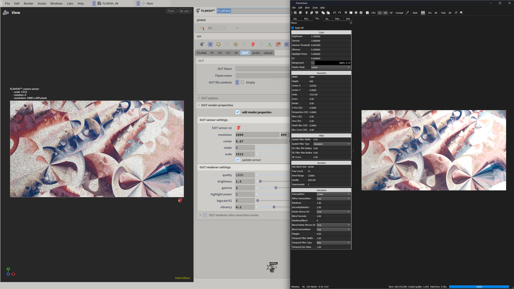</p>
<b><p align="center">FLAM3H_camera_sensor_to_Fractorium_01.jpg</b>
<p align="center">......</p>
<p align="center">

<b>GITHUB</b>

```
https://github.com/alexnardini/FLAM3_for_SideFX_Houdini/blob/main/icons/hda_doc/FLAM3H_camera_sensor_to_Fractorium_01.jpg
```
<p align="center">...</p></br/></br/></br/></br/>


<p align="center"><i>Genetic Spiral - author: F stands for liFe</i></p>
<p align="center">
  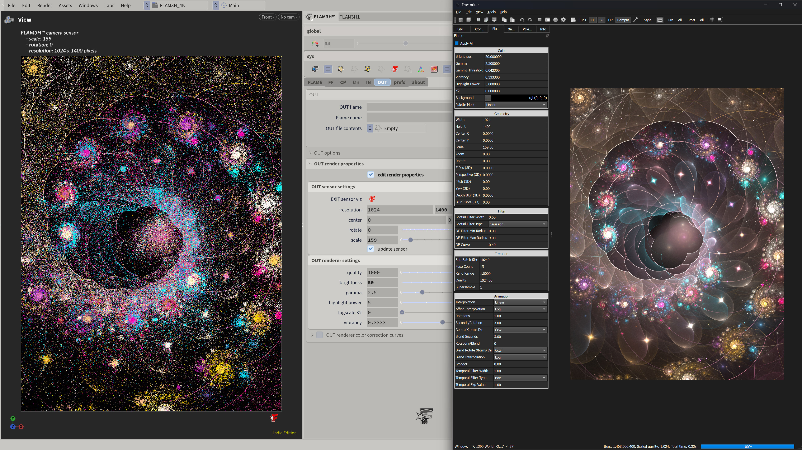</p>
<b><p align="center">FLAM3H_camera_sensor_to_Fractorium_02.jpg</b>
<p align="center">......</p>
<p align="center">

<b>GITHUB</b>

```
https://github.com/alexnardini/FLAM3_for_SideFX_Houdini/blob/main/icons/hda_doc/FLAM3H_camera_sensor_to_Fractorium_02.jpg
```
<p align="center">...</p></br/></br/></br/></br/>


<p align="center"><i>Sphere Sugar Dragon - author: Pillemaster</i></p>
<p align="center">
  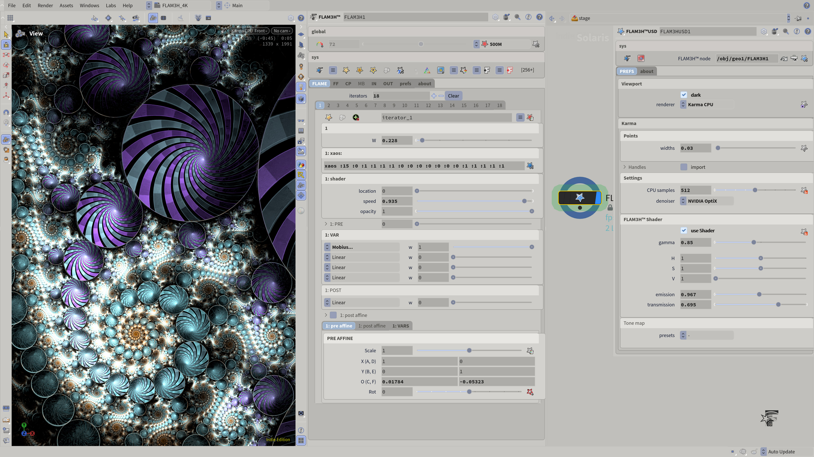</p>
<b><p align="center">FLAM3H_Hviewport_00_Karma.jpg</b>
<p align="center">......</p>
<p align="center">

<b>GITHUB</b>

```
https://github.com/alexnardini/FLAM3_for_SideFX_Houdini/blob/main/icons/hda_doc/FLAM3H_Hviewport_00_Karma.jpg
```
<p align="center">...</p></br/></br/></br/></br/>


<p align="center"><i>Worlds - author: F stands for liFe</i></p>
<p align="center">
  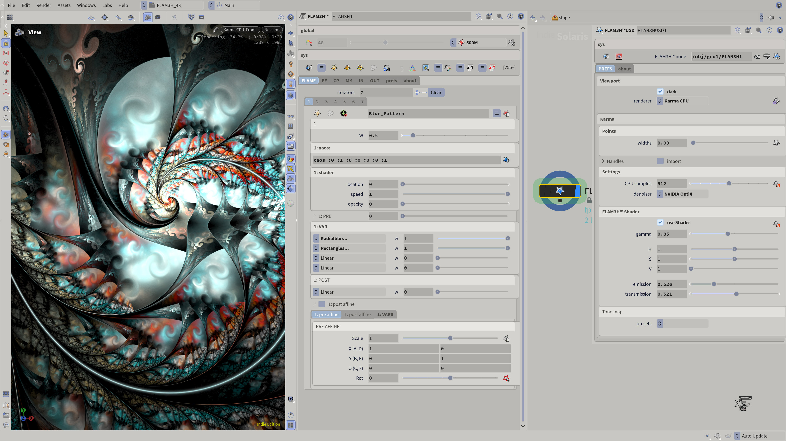</p>
<b><p align="center">FLAM3H_Hviewport_01_Karma.jpg</b>
<p align="center">......</p>
<p align="center">

<b>GITHUB</b>

```
https://github.com/alexnardini/FLAM3_for_SideFX_Houdini/blob/main/icons/hda_doc/FLAM3H_Hviewport_01_Karma.jpg
```
<p align="center">...</p></br/></br/></br/></br/>


<p align="center"><i>It's Pink - author: Plangkye</i></p>
<p align="center">
  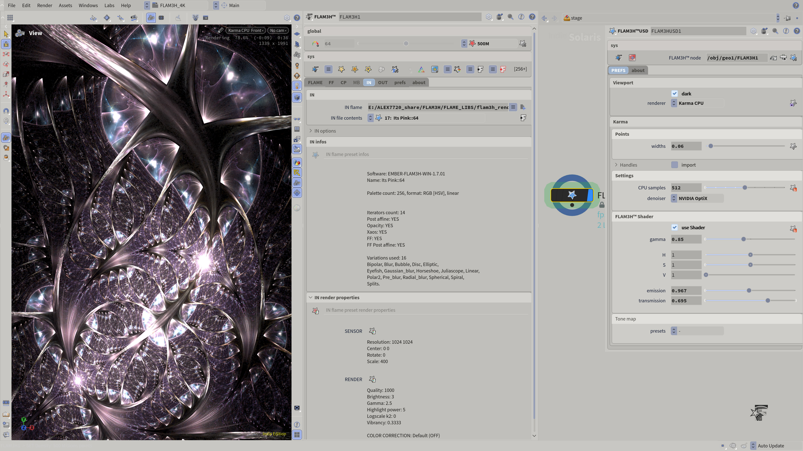</p>
<b><p align="center">FLAM3H_Hviewport_02_Karma.jpg</b>
<p align="center">......</p>
<p align="center">

<b>GITHUB</b>

```
https://github.com/alexnardini/FLAM3_for_SideFX_Houdini/blob/main/icons/hda_doc/FLAM3H_Hviewport_02_Karma.jpg
```
<p align="center">...</p></br/></br/></br/></br/>


<p align="center"><i>Dancing Stars - author: F stands for liFe</i></p>
<p align="center">
  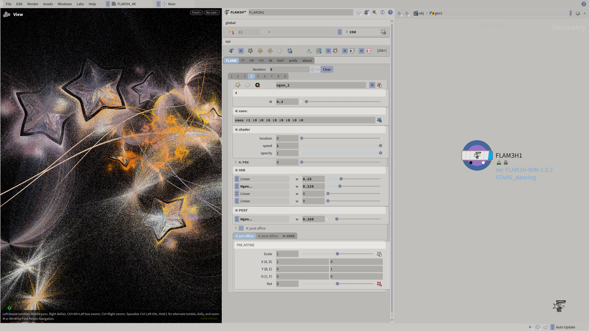</p>
<b><p align="center">FLAM3H_Hviewport_01_H.jpg</b>
<p align="center">......</p>
<p align="center">

<b>GITHUB</b>

```
https://github.com/alexnardini/FLAM3_for_SideFX_Houdini/blob/main/icons/hda_doc/FLAM3H_Hviewport_01_H.jpg
```
<p align="center">...</p></br/></br/></br/></br/>


<p align="center"><i>Crystal Eggs - author: F stands for liFe</i></p>
<p align="center">
  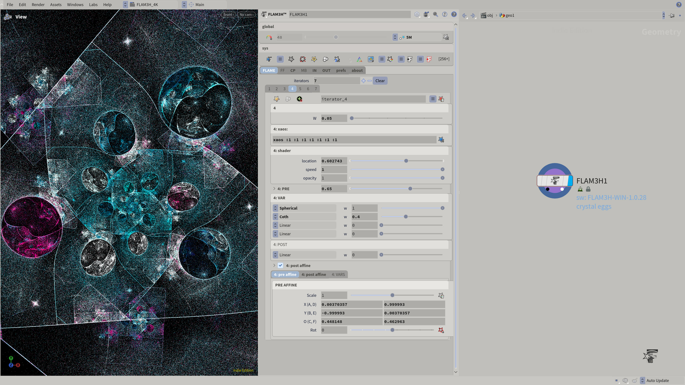</p>
<b><p align="center">FLAM3H_Hviewport_02_H.jpg</b>
<p align="center">......</p>
<p align="center">

<b>GITHUB</b>

```
https://github.com/alexnardini/FLAM3_for_SideFX_Houdini/blob/main/icons/hda_doc/FLAM3H_Hviewport_02_H.jpg
```
<p align="center">...</p></br/></br/></br/></br/>


<p align="center"><i>Cool EDisc - author: Pillemaster</i></p>
<p align="center">
  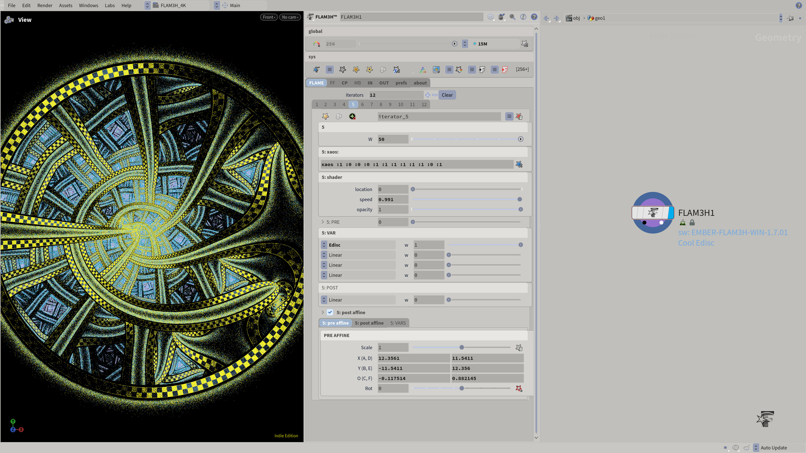</p>
<b><p align="center">FLAM3H_Hviewport_03_H.jpg</b>
<p align="center">......</p>
<p align="center">

<b>GITHUB</b>

```
https://github.com/alexnardini/FLAM3_for_SideFX_Houdini/blob/main/icons/hda_doc/FLAM3H_Hviewport_03_H.jpg
```
<p align="center">...</p></br/></br/></br/></br/>


<p align="center"><i>Golden Dragon - author: meckie</i></p>
<p align="center">
  </p>
<b><p align="center">237032379-56571708-d00a-4b93-ab2b-ea773700dce5.jpg</b>
<p align="center">......</p>
<p align="center">

<b>GITHUB</b>

```
https://user-images.githubusercontent.com/42110232/237032379-56571708-d00a-4b93-ab2b-ea773700dce5.jpg
```
<p align="center">...</p></br/></br/></br/></br/>


<p align="center"><i>Knot Clusters - author: F stands for liFe</i></p>
<p align="center">
  </p>
<b><p align="center">FLAM3H_knotCluster_HQ_iter_6.jpg</b>
<p align="center">......</p>
<p align="center">

<b>GITHUB</b>

```
https://github.com/alexnardini/FLAM3_for_SideFX_Houdini/blob/main/icons/hda_doc/FLAM3H_knotCluster_HQ_iter_6.jpg
```
<p align="center">...</p></br/></br/></br/></br/>


<p align="center">
  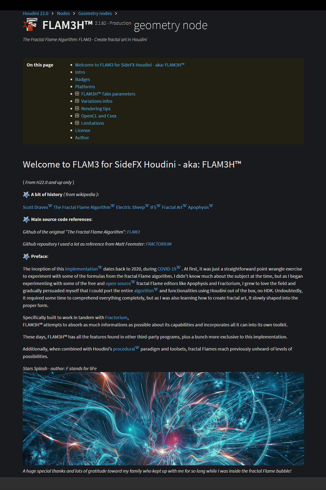</p>
<b><p align="center">FLAM3H_OTL_documentation.jpg</b>
<p align="center">......</p>
<p align="center">

<b>GITHUB</b>

```
https://github.com/alexnardini/FLAM3_for_SideFX_Houdini/blob/main/icons/hda_doc/FLAM3H_OTL_documentation.jpg
```
<p align="center">...</p></br/></br/></br/></br/>


<p align="center">
  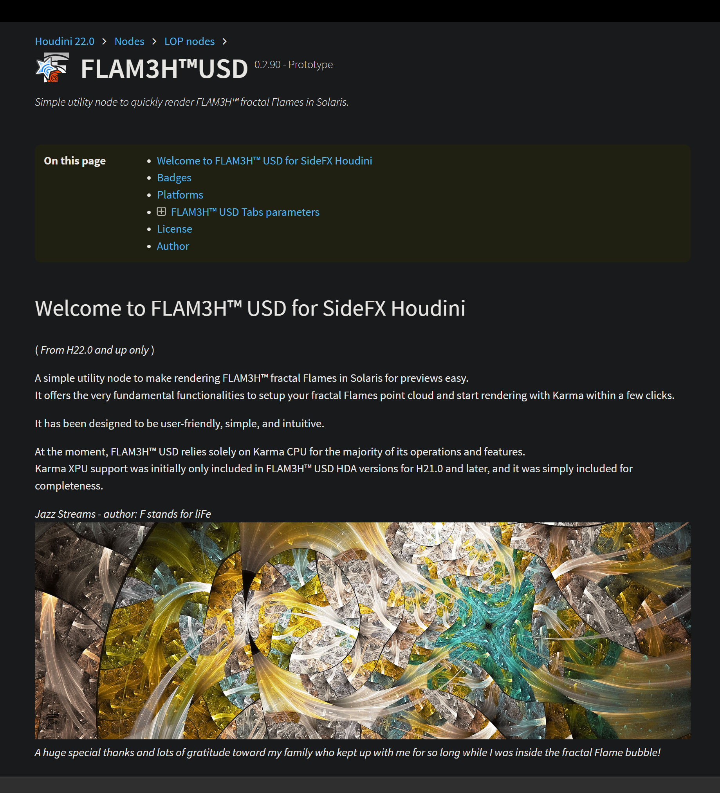</p>
<b><p align="center">FLAM3HUSD_OTL_documentation.jpg</b>
<p align="center">......</p>
<p align="center">

<b>GITHUB</b>

```
https://github.com/alexnardini/FLAM3_for_SideFX_Houdini/blob/main/icons/hda_doc/FLAM3HUSD_OTL_documentation.jpg
```
<p align="center">...</p></br/></br/></br/></br/>


<p align="center"><i>Flipped disc - author: Fractorium</i></p>
<p align="center">
  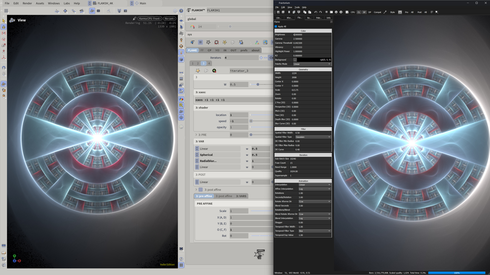</p>
<b><p align="center">FractoriumToFLAM3HOUDINI_00.jpg</b>
<p align="center">......</p>
<p align="center">

<b>GITHUB</b>

```
https://github.com/alexnardini/FLAM3_for_SideFX_Houdini/blob/main/icons/hda_doc/FractoriumToFLAM3HOUDINI_00.jpg
```
<p align="center">...</p></br/></br/></br/></br/>


<p align="center"><i>Mountain - author: tatasz</i></p>
<p align="center">
  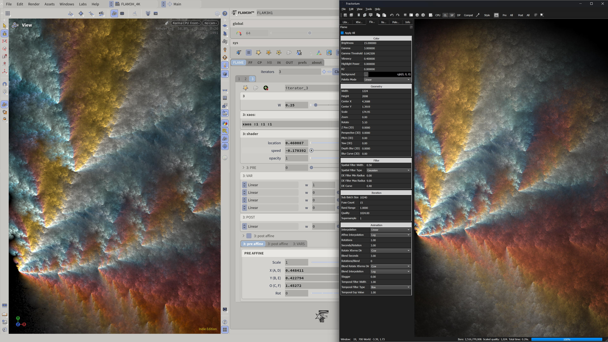</p>
<b><p align="center">FractoriumToFLAM3HOUDINI_01.jpg</b>
<p align="center">......</p>
<p align="center">

<b>GITHUB</b>

```
https://github.com/alexnardini/FLAM3_for_SideFX_Houdini/blob/main/icons/hda_doc/FractoriumToFLAM3HOUDINI_01.jpg
```
<p align="center">...</p></br/></br/></br/></br/>


<p align="center"><i>Bipolar - author: tatasz</i></p>
<p align="center">
  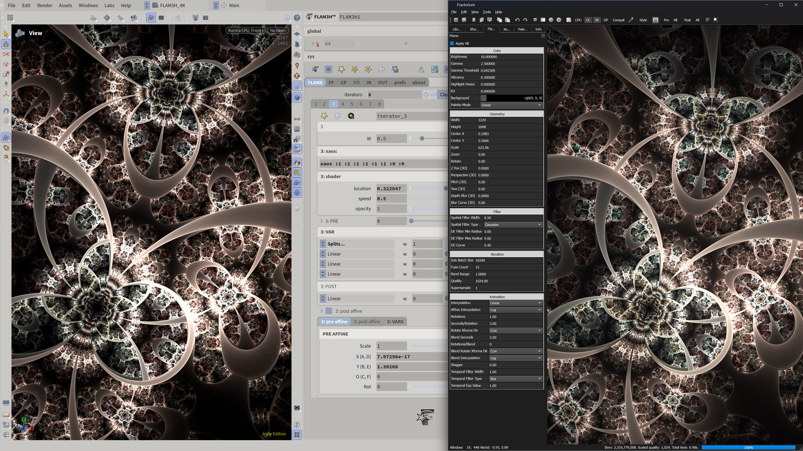</p>
<b><p align="center">FractoriumToFLAM3HOUDINI_02.jpg</b>
<p align="center">......</p>
<p align="center">

<b>GITHUB</b>

```
https://github.com/alexnardini/FLAM3_for_SideFX_Houdini/blob/main/icons/hda_doc/FractoriumToFLAM3HOUDINI_02.jpg
```
<p align="center">...</p></br/></br/></br/></br/>

<p align="center"><i>Chocolate scaffolds in too many dimensions - author: Plangkye</i></p>
<p align="center">
  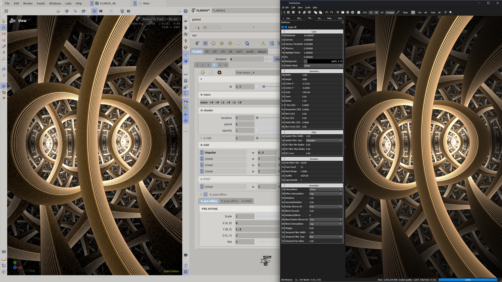</p>
<b><p align="center">FractoriumToFLAM3HOUDINI_03.jpg</b>
<p align="center">......</p>
<p align="center">

<b>GITHUB</b>

```
https://github.com/alexnardini/FLAM3_for_SideFX_Houdini/blob/main/icons/hda_doc/FractoriumToFLAM3HOUDINI_03.jpg
```
<p align="center">...</p></br/></br/></br/></br/>


<p align="center"><i>Cool EDisc - author: Pillemaster</i></p>
<p align="center">
  </p>
<b><p align="center">GITHUB_intro_img.jpg</b>
<p align="center">......</p>
<p align="center">

<b>GITHUB</b>

```
https://github.com/alexnardini/FLAM3_for_SideFX_Houdini/blob/main/icons/hda_doc/GITHUB_intro_img.jpg
```
<p align="center">...</p></br/></br/></br/></br/>


<p align="center">
  </p>
<b><p align="center">LOGO_F_github.svg</b>
<p align="center">......</p>
<p align="center">

<b>GITHUB</b>

```
https://github.com/alexnardini/FLAM3_for_SideFX_Houdini/blob/main/icons/hda_doc/LOGO_F_github.svg
```
<p align="center">...</p></br/></br/></br/></br/>

<br/>
<br/>
<br/>
<br/>

_Copyright (c) 2021 F stands for liFe_<br/>